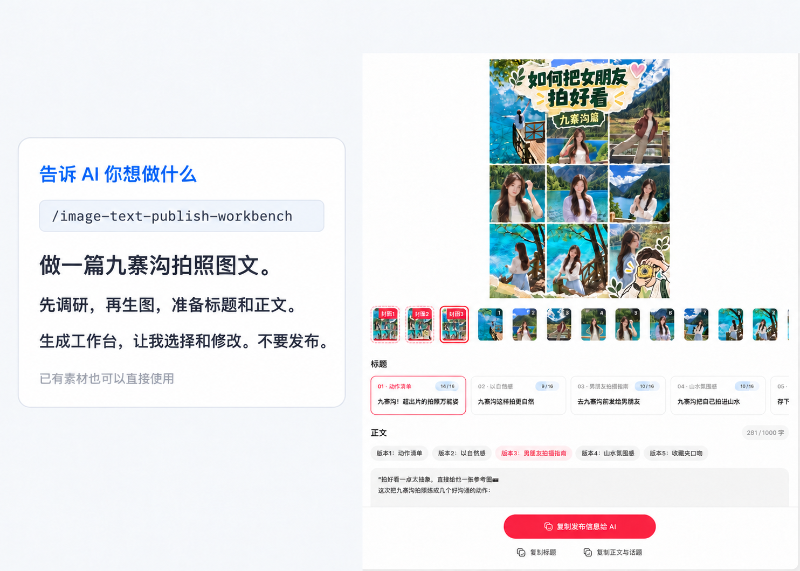
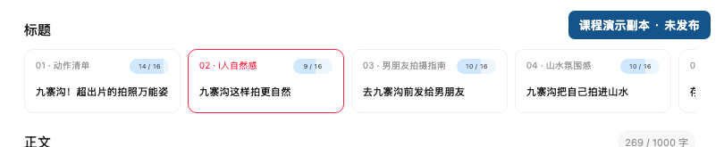
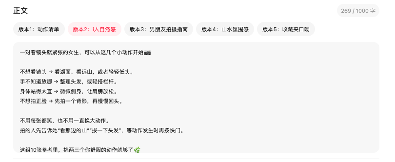
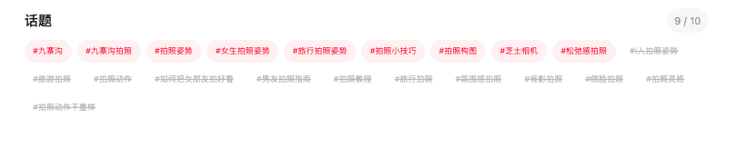

# Image & Text Publishing Workbench

[简体中文](README.zh-CN.md) · [Agent skill](SKILL.md) · MIT

**Turn existing images and draft copy into one local page where you can preview, edit, choose, and copy the final publishing package.**

When covers are in a folder and several drafts are in a chat, the last step is easy to get wrong. This workbench puts your choices together before you hand them off.

## Tell your AI what to prepare

Place the complete repository in a Skill directory supported by your assistant. If it supports slash invocation, use the example below. Otherwise ask it to read this repository's `SKILL.md`; slash syntax is assistant-specific, not a button in the generated page.

```text
/image-text-publish-workbench
Prepare an image/text post about organizing a desk for beginners.
Research the topic, draft headline/body/hashtag options, and generate missing images and covers.
If I supply a reference gallery, use its layout and palette, replacing old subjects and copy.
Build the workbench so I can choose and edit. Do not publish.
```

Replace the topic with a product introduction, tutorial, travel note, educational card or other idea. Image content and count follow your brief; no pose-specific preset is required.

| Option | What to request |
|---|---|
| Research | Research first, or use only my supplied material |
| Images | Generate missing assets, or reuse my images |
| Gallery reference | Follow my authorized gallery layout/palette, or use no gallery |
| Full preparation | Start from the topic, prepare research, assets and copy, then build the workbench |

Research and image-production instructions, prompt templates and the local image utility are bundled in this repository. Your assistant supplies authorized browser/search and native image-generation tools. With no such tools, you can still build from existing material. No accounts, provider credentials or author's other private skills are required. Tool availability, login and any paid budget must be handled explicitly.

See [capability origins and scope](docs/capability-origins.md).

[Preparation brief example](examples/preparation-brief.json) is for the Agent; the renderer still uses its original input schema.

## See the workbench



Compare covers and image order, then choose the headline and body you want to use. The bottom button copies your selected publishing information for handoff to an AI assistant.

This privacy-masked illustration is based on the presentation example. Conversation content and local paths are covered in pale white; the left card is a suggested invocation, not an execution receipt. The screenshots below show the actual teaching interface in detail. The example does not demonstrate a successful platform post.

### Choose a headline



### Choose and edit the body



### Select topics



The teaching case uses Chinese content. Your own images, headlines and body text replace these materials when you build a workbench.


## Typical uses

- Creators comparing covers, arranging pages, and choosing a headline and body.
- Content teams reviewing an AI draft together without searching through a chat.
- Tutorials, product introductions, or photo essays that already have source images.
- Agent users who want AI to prepare candidates and a person to make the final choice.

The HTML builder does not call an image model or publish to social networks. The bundled Agent workflow can optionally research and generate assets before building. `xiaohongshu` is the default handoff platform identifier, not a promise of complete platform integration.

## Start with a safe demo

1. Download the ZIP using **Code → Download ZIP**, or clone this repository.
2. Reuse an existing Python 3.10+ environment if available. From the repository directory:

```bash
python3 -m pip install -r requirements.txt
python3 examples/create_demo.py
```

3. Open `output/demo.html` locally. Choose a title and body independently, toggle tags, replace a cover, and reorder pages.
4. Use the bottom buttons to copy the current selection, title, or body with tags.

The demo creates clearly labeled synthetic diagrams, not real photos. Generated output is ignored by Git. The browser UI and detailed agent instructions currently use Chinese; both introductory guides are bilingual.

### Use it with an AI companion

Place the whole repository folder in a Skill directory supported by your Agent. Follow that Agent's local installation instructions. An Agent with file access can also read `SKILL.md` directly.

> Read this workbench Skill. Use my attached pictures and draft to prepare two title candidates and two body versions, then build a local review page. Keep source files unchanged. I will make the final selection; do not publish.

The Agent prepares structured JSON and invokes the scripts. The resulting page does not call a model or require an API key.

### Bring your own materials

Copy `examples/workbench-input.json` and follow the [input contract](references/input-contract.md). Each registered image uses an existing absolute local path. Empty image arrays are allowed for upload slots; at least one title and one body candidate are required.

```bash
python3 scripts/validate_workbench.py --input /absolute/path/input.json
python3 scripts/build_workbench.py --input /absolute/path/input.json --output /absolute/path/workbench.html
```

The builder outputs HTML, normalized `.input.json`, and an `.assets.json` manifest. Image previews are embedded in HTML. Editing in the browser does not rewrite the original HTML or input JSON.

## Detailed capabilities

### Preparation capabilities

- Research comparable content and facts for the user's topic, recording sources, visible metrics and gaps.
- Reuse supplied images or use an available image tool to make topic-specific assets and covers.
- Optionally follow a user-authorized gallery's layout, palette and typography while preserving originals.
- Draft headline, body and hashtag candidates from actual materials, then build the editable workbench.

**Can preparation run from one request?** Yes, when your assistant has the necessary tools, asset permission and budget. It must report missing access or evidence; the static HTML does not call a model by itself.


| Capability | What you can do | Boundary |
|---|---|---|
| Cover comparison | Select a front-of-strip cover thumbnail | Fewer than three covers get upload slots; larger sets follow input order |
| Page organization | Add, remove, replace, and reorder inner pages | Source images are not overwritten; cover remains the first handoff image |
| Title candidates | Edit and select a title directly | Independent of body choices; no fixed five-candidate requirement |
| Body variants | Switch and edit separate versions | Each variant keeps its own edits |
| Tag selection | Choose or deselect relevant tags | No claim of verified popularity or traffic |
| Image uploads | Pick files or drag in JPEG, PNG, WebP | Actual decoding, size, dimensions, and SHA-256 checks; static images only |
| Draft recovery | Save edits and uploaded originals in the current browser | Storage may be disabled or cleared; URL and browser changes affect recovery |
| Capacity checks | See title, composed body, and tag limit warnings | Defaults 16/1000/10 are workbench settings, not current official platform rules |
| Current-state copy | Copy selected text and image information | Missing cover or unrestored images block complete handoff; manual copy fallback |
| Asset materialization | Save browser uploads as verified local files | Verify all assets before writing; no network upload |
| Portable preview | Review an HTML page locally | Embedded original images; edits are not written back into source HTML |

Default budgets: 32 MiB per image, 200 MiB per set, 36 million pixels per image. Previews keep aspect ratio. EXIF orientation is reflected in display dimensions; original image bytes and metadata are preserved during handoff.

## Hand off the reviewed result

Browser uploads have no known absolute path. Never infer one from a filename. Save the copied publishing information as text or export the selection object as JSON, then run:

```bash
python3 scripts/materialize_selection.py --selection /absolute/path/publish-selection.json --output-dir /absolute/path/current-assets
```

This writes verified uploaded originals and `publish-selection.resolved.json`. A separately authorized workflow handles actual publication. For Agent integrations:

```javascript
await window.workbenchReady;
const selection = await window.getPublishReviewSelection();
const draft = await window.getWorkbenchDraft();
```

## FAQ

**Can I start without images?** Yes. Empty slots accept uploads later. A complete handoff requires a valid selected cover.

**Do I need five titles and bodies?** No. One of each is enough, and selections are independent.

**Does opening the page run AI?** No. An Agent prepares materials upstream; this page is for review and organization.

**Does it publish automatically?** No. No platform login is required. You choose the next publishing workflow yourself.

**Why did my draft disappear after refresh?** Browser storage may be blocked, cleared, or scoped to a different URL. Keep a separate backup of the current selection.

**What if clipboard access fails?** The UI provides a manual-copy fallback. Review copied text before using it.

**Will replacing an image overwrite the source?** No. Replacement is stored in the browser draft; materialization writes to your chosen output directory.

**Can I share generated HTML?** Yes, after checking privacy. It embeds original image previews and includes local paths; never commit private generated output.

**Does it strip image GPS or EXIF?** No. Original bytes are preserved. Sanitize metadata separately before public sharing.

**Can I use it for another platform?** You can configure identifiers and limits. This does not automatically implement platform-specific adapters or verify live publishing rules.

## Validation and contribution

```bash
python3 scripts/test_workbench.py
```

Regression checks cover construction, state, image fingerprints, and handoff. Script success is not visual browser acceptance. See [verification](docs/verification.md), [SKILL.md](SKILL.md), and the [input contract](references/input-contract.md).

## Privacy and license

This public copy removes private execution history and author-specific cover and promotion defaults. The demo uses only synthetic images and generic text. Generated pages can contain your images, text, paths, and metadata; keep them private by default.

Original code and documentation use [MIT](LICENSE). Your photos, fonts, brands, and third-party assets retain their own rights.
