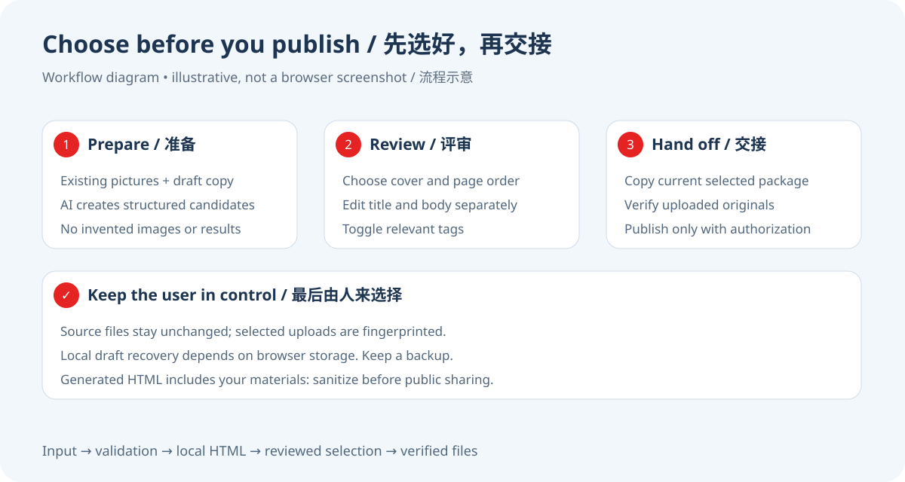
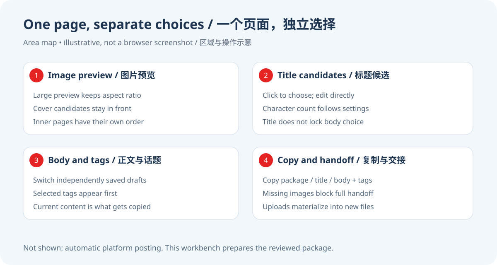

# 图文发布工作台

[English](README.md) · [完整 Skill](SKILL.md) · MIT

**把已有图片和 AI 准备的文案，整理成一个能预览、修改、选择并复制发布信息的本地页面。**

图片在文件夹里，标题在聊天里，正文还有好几个版本。真正发布之前，你需要把它们放在一起，看清这次到底用哪张图、哪句话。这个工作台负责这一步。



## 适合哪些场景

- 图文创作者：对比几张封面，调整内页顺序，再选标题和正文。
- 品牌或内容团队：把 AI 草稿交给同事复核，直接在同一个页面改。
- 教程、产品介绍、城市散步等题材：已有图片，想整理成一份可交接的发布材料。
- 使用 AI 伙伴的人：让 AI 先准备候选，自己最后选择，不必在聊天记录里翻找。

工作台不生成图片，也不自动发布到社交平台。默认平台标识是 `xiaohongshu`；这是交接信息，不代表已经完成所有平台适配。

## 第一次使用

这是一个可供 AI 读取的 Skill，也包含能直接运行的脚本。你不需要先配置社交平台账号。

1. 点击 GitHub 的 **Code → Download ZIP**，解压；或者克隆此仓库。
2. 使用 Python 3.10+。如果已有可用的 Python 环境，直接复用。在仓库目录安装依赖：

```bash
python3 -m pip install -r requirements.txt
```

3. 先跑全部使用合成图片的示例：

```bash
python3 examples/create_demo.py
```

4. 打开生成的 `output/demo.html`。点击标题、正文版本和话题，尝试上传自己的封面，再检查内页顺序。
5. 页面底部有 **复制发布信息给 AI**、**复制标题**、**复制正文与话题**。复制得到的是当前选择与编辑后的内容。

示例图片上写着 SYNTHETIC DEMO，只演示材料组织方式，不是实际拍摄作品。`output/` 默认不进入 Git。

### 让 AI 伙伴来准备

把整个仓库文件夹放进你的 Agent 支持的 Skill 目录。不同 Agent 的安装位置不同；以它的本地说明为准。也可以直接让能读取本地文件的 Agent 先读 `SKILL.md`。

> 请读取图文发布工作台 Skill。我已有这些图片和这份正文，帮我整理两个标题、两个正文版本，生成本地工作台。保留原文件，完成后我来选择，不发布。

把图片作为附件或提供存在的文件路径。AI 准备输入 JSON，然后运行校验与构建脚本；页面本身不连接模型，也不需要 API key。

### 使用自己的材料

复制 `examples/workbench-input.json`，按 [输入合同](references/input-contract.md) 修改。图片的 `path` 必须是你电脑上存在的绝对路径；没有图片时可以留空槽，在页面上传。标题和正文各至少一个候选。

```bash
python3 scripts/validate_workbench.py --input /absolute/path/input.json
python3 scripts/build_workbench.py --input /absolute/path/input.json --output /absolute/path/workbench.html
```

产物包括 HTML、规范输入 `.input.json` 和素材清单 `.assets.json`。HTML 内嵌图片预览，可在源图片移动后继续看图；要把图片交给后续任务时，仍会核验原路径和内容。

## 能做什么



| 能力 | 你可以做什么 | 具体边界 |
|---|---|---|
| 封面比较 | 前置封面缩略图，点击选中 | 少于三张补上传空槽；多于三张按输入展示 |
| 内页整理 | 增加、移除、替换及调整内页顺序 | 不覆盖原始图片；封面始终是交接首图 |
| 标题候选 | 直接编辑并选择标题 | 与正文独立，不强制五套 |
| 正文版本 | 独立编辑和切换各版本 | 切换不会把别的版本覆盖 |
| 话题选择 | 查看、选择或取消话题 | 不承诺热度；来源未知保留未知 |
| 图片上传 | 点击或拖入 JPEG、PNG、WebP | 实际解码、尺寸、大小及内容指纹校验；仅静态图片 |
| 草稿恢复 | 当前浏览器后台保存编辑和上传原图 | 依赖浏览器存储；清理数据、换地址或换浏览器可能影响恢复 |
| 内容检查 | 提醒标题、正文与话题数量超限 | 默认 16/1000/10 是工作台配置，不是平台实时官方限制 |
| 当前稿复制 | 复制当前标题、正文、话题和所选图片信息 | 缺封面或有未恢复图片时阻断完整交接；失败可手动复制 |
| 素材落盘 | 把页面上传的原图变成可核验的本地文件 | 先验证全部图片，再写入指定目录；不上传网络 |
| 单文件预览 | 在本地打开 HTML 评审 | 图片内嵌；编辑不会自动写回原 HTML |

默认资源预算：单图 32 MiB、整组 200 MiB、每张不超过 3600 万像素。预览保留比例，不自动裁图。EXIF 方向会用于展示尺寸；原始图片字节和元数据不会因落盘而改变。

## 把选好的材料交给下一步

页面复制的发布信息含当前稿和图片。浏览器上传图片没有天然本地路径，因此不能凭文件名猜测它在哪个文件夹。

把复制内容保存为文本，或把页面接口返回的选择对象保存为 JSON，再运行：

```bash
python3 scripts/materialize_selection.py --selection /absolute/path/publish-selection.json --output-dir /absolute/path/current-assets
```

脚本会输出 `publish-selection.resolved.json` 并落盘上传原图。实际发布需要另外获得授权的任务接手。开发者可读取：

```javascript
await window.workbenchReady;
const selection = await window.getPublishReviewSelection();
const draft = await window.getWorkbenchDraft();
```

## 常见问题

**没有图片还能用吗？** 可以先生成空槽，再上传；完整发布交接需要选好可用封面。

**只有一套标题和正文可以吗？** 可以，至少各一套即可，不必凑满五套。

**打开 HTML 就会自动调用 AI 吗？** 不会。AI 在上游准备材料，页面负责评审与整理。

**会替我发布吗？** 不会，也不需要社交平台登录。复制信息后再交给你授权的发布流程。

**为什么刷新后没恢复？** 浏览器存储可能被禁用或清理，文件地址也可能变了。保留当前稿备份，不把浏览器自动保存当唯一备份。

**为什么复制按钮被拦截？** 本地页面可能没有剪贴板权限；页面提供手动复制方式。检查最终复制内容后再使用。

**图片上传会覆盖原文件吗？** 不会；替换发生在页面草稿中，落盘写到你指定的输出目录。

**能给其他人发生成的 HTML 吗？** 可以，但它包含原图预览和素材路径；先自行脱敏。不应把含隐私的生成文件提交到公开仓库。

**会自动去掉照片的位置和 EXIF 吗？** 不会，上传原图与落盘保留字节。公开分享前单独检查和处理图片元数据。

**支持其他平台吗？** 输入可设置平台标识和容量；它不自动适配所有平台，也不核验实时发布规则。

## 验证与开发

```bash
python3 scripts/test_workbench.py
```

回归覆盖构建、编辑状态、图片指纹与素材交接。自动脚本不等于浏览器视觉验收。发布检查见 [验证记录](docs/verification.md)。完整使用约定见 [SKILL.md](SKILL.md) 和 [输入合同](references/input-contract.md)。

## 隐私与许可证

此公开副本清除了私人执行记录、特定作者的封面与品牌推广偏好。示例仅使用合成图和通用文案。生成文件可能包含你输入的正文、图片、路径和元数据，默认保存在 Git 忽略的目录。

代码和原创文档采用 [MIT](LICENSE)。你提供的照片、字体、品牌和第三方素材仍遵守各自权利，不因工作台导出而转为 MIT。
